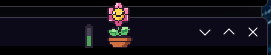
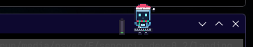
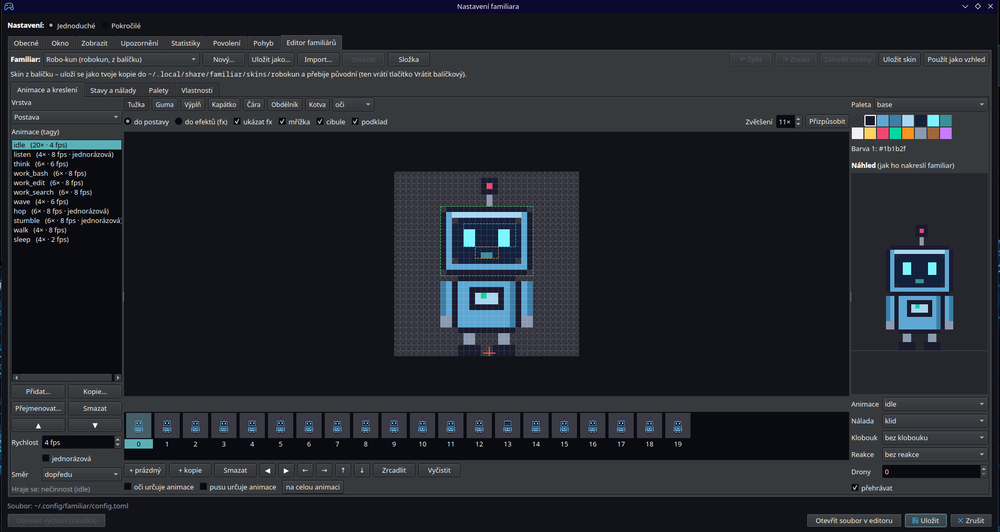

# Pixel Familiars

Pixelová postavička, která ukazuje, co právě dělá Claude Code. Pro každou běžící
session `claude` vznikne jedna postavička: přemýšlí, pracuje s nástroji, mává, když čeká
na povolení, zakopne při chybě a usne, když se nic neděje. K tomu má náladu odhadnutou
z průběhu rozhovoru a klobouk podle tématu. Návrh a model nálady popisuje
[pixel-familiars-koncept.md](pixel-familiars-koncept.md).

## Ukázky

Postavička sedí na titulku okna terminálu. Baterka vedle ní je měřič obsazení kontextu.

| | |
|---|---|
|  |  |
|  |  |
|  |  |
|  |  |

Skiny Robo-kun, Květina, Robo-kun Rubín a vánoční Robo-kun (`vanoce`). Robo-kun má dalších šest barevných variant (`familiar skins` vypíše všechny).

## Požadavky

- Linux s grafickým prostředím. Režim *perch* (postavička sedí na titulku okna terminálu,
  ve kterém běží `claude`) funguje na **KDE Plasma 6**, v **X11 session** se správcem oken
  s EWMH a na **GNOME Waylandu s rozšířením** familiara, viz [Prostředí](#prostředí). Jinde,
  nebo když perch nejde spustit, běží režim *dock*: všechny postavičky v jednom okně.
- Python 3.11 nebo novější, PySide6 (stačí PySide6-Essentials ≥ 6.5) a tomlkit. Instalátor
  si je stáhne sám, bez sítě viz [Instalace bez sítě](#instalace-bez-sítě).
- `uv` (doporučeno) nebo `pipx`.
- Claude Code (postavičky běží z jeho hooků).

## Instalace

```sh
git clone <adresa-repozitáře> pixel-familiars
cd pixel-familiars
sh install.sh                # nebo: sh install.sh --autostart
```

`install.sh` udělá tohle:

1. Nainstaluje balíček jako nástroj: `uv tool install`, jinak `pipx install`, jinak venv
   bez sítě. Instaluje se kopie, nainstalovaný familiar na repozitáři nezávisí.
2. Spustí `familiar install`, který přidá:
   - odkazy `~/.local/bin/familiar` a `~/.local/bin/familiar-emit`,
   - hooky (13 událostí, příkaz `familiar-emit claude-code`) do `~/.claude/settings.json`.
     Ostatní klíče zůstanou, jak byly, původní soubor se nejdřív zazálohuje do
     `~/.local/share/familiar/backup/<čas>/`,
   - na KDE pravidlo KWinu „vždy navrchu“ do `~/.config/kwinrulesrc`,
   - s volbou `--gnome-rozsireni` rozšíření GNOME Shellu (viz [Prostředí](#prostředí)),
   - spouštěč `~/.local/share/applications/familiar.desktop` (položka „Familiar“
     v nabídce aplikací),
   - s volbou `--autostart` i `~/.config/autostart/familiar.desktop`.

`familiar install` můžeš spouštět opakovaně, co je hotové, přeskočí. Před změnou ukáže,
co by udělal, volba `--dry-run`.

### Instalace bez sítě

`install.sh` nejdřív zkusí spojení s pypi.org (nejvýš 3 s). Bez sítě pak:

1. `uv tool install --offline`: PySide6-Essentials, shiboken6 a tomlkit vezme z cache uv
   (`~/.cache/uv`), pokud tam jsou z dřívější instalace (familiara nebo jiného nástroje).
2. Když v cache nejsou (nebo uv chybí), založí venv se systémovými balíčky
   v `~/.local/share/familiar/venv-<čas>` a familiar do něj nainstaluje přes
   `pip --no-index`. PySide6 ≥ 6.5 a tomlkit musí jít importovat v `python3`, např.
   z `~/.local/lib/python3.*/site-packages` nebo ze systémových balíčků. Když nejdou,
   instalátor skončí s chybou a hooky ani odkazy nezmění.

Familiar sám se sestaví bez sítě (vlastní backend v `_build/`, bez setuptools).

Spuštění: z nabídky aplikací („Familiar“), nebo z terminálu:

```sh
setsid -f familiar run >/dev/null 2>&1     # na pozadí; `familiar run` běží v popředí
familiar doctor                            # všechno by mělo být OK
```

Hooky se načtou v nových session Claude Code. Session, které už běží, je potřeba
spustit znovu.

## Aktualizace

```sh
cd pixel-familiars && git pull && sh install.sh
# nebo odkudkoli (repozitář musí být na původním místě):
familiar upgrade
```

Pak restartuj daemon, protože jinak běží dál stará verze:

```sh
familiar stop && setsid -f familiar run >/dev/null 2>&1
```

Konfiguraci převede `familiar install`, který spouští `install.sh` i `familiar upgrade`.
Podle klíče `verze` ji převede na nové schéma a původní soubor uloží do zálohy. Běžící
daemon si starší soubor převede jen v paměti.

## Prostředí

Polohu cizích oken, aktivní okno a přepnutí do terminálu zařizuje *backend oken*. Vybírá se sám
podle `XDG_CURRENT_DESKTOP` a `XDG_SESSION_TYPE`, přepsat ho jde klíčem `[okno] backend`
(`auto` / `kwin` / `x11` / `gnome` / `zadny`, změna platí po restartu daemonu). Který běží
a co mu chybí, ukáže `familiar doctor`.

| Prostředí | Backend | Perch (na titulku) | Vždy navrchu | Aktivní okno, přepnutí do terminálu |
| --- | --- | --- | --- | --- |
| KDE Plasma 6, Wayland | `kwin` | ano (KWin skript) | pravidlo KWinu | ano |
| KDE Plasma 6, X11 | `kwin` | ano (KWin skript, neověřeno) | pravidlo KWinu | ano |
| GNOME, Wayland | `gnome` | s rozšířením (jinak dock) | s rozšířením | s rozšířením (jinak neznámé) |
| GNOME na X11, jiné X11 (Xfce, Openbox, i3 …) | `x11` | ano, je-li správce oken s EWMH | `_NET_WM_STATE_ABOVE` | ano (`_NET_ACTIVE_WINDOW`) |
| jiný Wayland (Sway, Hyprland …) | `zadny` | ne, dock | ne | neznámé |

- **X11:** familiar čte stav oken sám přes libX11 (`_NET_CLIENT_LIST_STACKING`, `_NET_WM_PID`,
  `_NET_FRAME_EXTENTS`, `_NET_WM_DESKTOP`, `_NET_WM_STATE`), žádné nástroje nepotřebuje (xprop
  se hodí jen k ověření: `xprop -root _NET_SUPPORTED`). Polohy počítá Python přepis perch.js
  (`familiar/rozmisteni.py`), takže strana, odsazení, zakrytí, řada v rohu, procházky i bublina
  se chovají stejně jako na KDE.
- **GNOME Wayland:** cizí okna tam aplikace nevidí. `familiar install --gnome-rozsireni`
  nainstaluje malé rozšíření GNOME Shellu (45+) do
  `~/.local/share/gnome-shell/extensions/familiar@pixel-familiars/`, které nad okny Mutteru
  spouští tentýž perch.js a hlásí aktivní okno. Zapne ho `gnome-extensions enable
  familiar@pixel-familiars` (instalátor to zkusí sám); nově nainstalované rozšíření GNOME
  na Waylandu uvidí až po odhlášení a přihlášení. Postavičky se ukazují i v přehledu činností.
- **Bez backendu** (`zadny`) běží dock a upozornění neví, jestli je terminál aktivní (ukážou
  se i nad aktivním terminálem, brzdí je jen prodlevy a limity).

## Ovládání

| Kde | Co |
| --- | --- |
| Levý klik na postavičku (perch) | přepne na její terminál a šťouchne do ní (volba `[mys] klik`) |
| Prostřední tlačítko na postavičce | šťouchnutí |
| Klik / tažení / dvojklik (dock) | šťouchnutí / přesun okna / panel nálady |
| Rychlé klikání, hlazení, najetí myší | zamotá se a chvíli se zlobí / srdíčko / zbystří |
| Pravé tlačítko na postavičce | nabídka té postavičky |
| Ikona v liště, pravé tlačítko | stejná nabídka pro všechny postavičky |
| Ikona v liště, levý klik | panel nálady první postavičky |

Když jiné okno zakryje titulek terminálu, postavička na něm ve výchozím nastavení (`navrchu`)
zůstane, ale to okno ji zakryje stejně jako terminál: zakrytá část postavičky se nekreslí a klik
do ní jde do okna nad ní. Volba `[okno] zakryti` to mění: `schovat` ji schová (čekající si sedne do rohu),
`rada` ji posadí do řady v rohu obrazovky podle `rada_roh` (výchozí vpravo dole, nad panelem)
a po odkrytí titulku se vrátí. U minimalizovaného terminálu nebo terminálu na jiné ploše či
aktivitě se postavička schová vždy. Když je okno terminálu zakryté úplně (není z něj vidět nic),
postavička se v režimu `navrchu` také schová (čekající si sedne do rohu); v režimu `rada` zůstává
i úplně zakrytá v řadě.

Nabídka: *Panel nálady…*, *Statistiky a úspěchy…*, *Ztlumit emoty*, *Uspat* (z lišty *Uspat všechny*, *Notifikace*, *Zvuky*), *Režim
soustředění*, *Přepnout na dock/perch*, *Skin*, *Nastavení…*, *Ukončit familiara*.

- **Uloží se do `config.toml`:** emoty, soustředění, notifikace, zvuky, režim perch/dock a skin. Zapíše se jen
  změněný klíč, komentáře v souboru zůstanou. Když soubor neexistuje, vznikne až při první
  změně.
- **Neuloží se:** *Uspat*. Platí jen do ukončení daemonu. Probuzení jedné postavičky zruší
  *Uspat všechny* (ostatní spí dál).
- Když se config uložit nepodaří (rozbitý TOML), přepínač se vrátí a familiar to oznámí.

**Panel nálady** ukazuje graf valence a aktivace za poslední hodinu, aktuální štítek
nálady, téma, činnost a posledních 8 událostí. Otázka „Sedí nálada?“ má tlačítko pro
každý štítek: kliknutím buď odhad potvrdíš, nebo vybereš ten správný. Každá odpověď se
uloží jako jeden řádek do `~/.local/state/familiar/opravy.jsonl`.

**Statistiky a úspěchy** (okno z nabídky): záložka *Dnes* (session, prompty, nástroje, chyby,
aktivní čas, nejčastější nástroje, nálada po hodinách), *Týden* (graf po dnech, součty), *Úspěchy*
(úroveň, XP do další, odznaky – zamčené s popisem, jak je získat) a *Doplňky*. Odemčený klobouk
(od úrovně 3 kšiltovka, pak slamák, cylindr, koruna, za úspěchy noční čepička a vavřín) postavička
nosí, když téma rozhovoru nemá vlastní (`[postup] doplnek_klobouk`, `klobouk_vzdy`); skiny bez
klobouků ho nekreslí. Odemčené emoty občas ukáže v klidu (`emoty_v_klidu`, `klid_emote_s`).
Nová úroveň: krátká oslava a bublina „Úroveň 5!“. Okno ukazuje jen čísla a názvy nástrojů;
`familiar statistiky [--json]` vypíše totéž ze souborů i bez daemonu.

**`familiar tune`** z oprav spočítá přesnost, matici záměn a stav brány fáze 1
(aspoň 50 záznamů a přesnost aspoň 70 %). Od 20 záznamů (z toho aspoň 5 oprav) navrhne
posun prahů `[nalada.prahy]`. Sám nic nezapisuje, návrh vypíše jako TOML. Váhy signálů
se z oprav určit nedají, ladí se jen prahy.

## Nastavení

Soubor `~/.config/familiar/config.toml`. Když neexistuje, platí výchozí hodnoty. Běžící
daemon změny použije do 1 s bez restartu. Výjimkou je `okno.terminaly`: změna platí jen
pro nové postavičky.

```sh
familiar config --init       # komentovaný soubor s výchozími hodnotami (--force přepíše, se zálohou)
familiar config --check      # kontrola; exit 1 při chybě
familiar config --show       # efektivní hodnoty
familiar config --path       # cesta k souboru
familiar nastaveni           # dialog nastavení (to samé jako Nastavení… v nabídce)
familiar editor [id]         # dialog nastavení na záložce Editor familiárů
```

Dialog má nahoře přepínač *Jednoduché* / *Pokročilé*. Jednoduchý režim (výchozí) ukazuje
jen běžné volby: kde postavička sedí, skin, tichý režim a soustředění, velikost, stranu,
chování při zakrytí titulku a zapnutí vrstev. Pokročilý ukazuje všechno. Zvolený režim se
pamatuje v klíči `nastaveni`.

Když má klíč chybnou hodnotu, použije se pro něj výchozí. Rozbitý TOML znamená, že
platí výchozí hodnoty pro celý soubor. Neznámé klíče vyvolají jen varování.

| Sekce | Obsah |
| --- | --- |
| (nahoře) | `verze` (neměnit), `rezim` (auto/perch/dock), `skin`, `tichy`, `soustredeni`, `nastaveni` (jednoduche/pokrocile: režim dialogu nastavení) |
| `[okno]` | měřítko pixelů v docku a na okně, strana a odsazení na titulku, mezery, perioda snímků, názvy procesů terminálů, `backend` oken (viz [Prostředí](#prostředí)) |
| `[zobrazit]` | zapnutí vrstev: nálada, klobouky, emoty, drony subagentů |
| `[klid]` | jak dlouho visí emote, rozestup emotů, délka fronty |
| `[postavicka]` | ustálení stavu, odchod po konci session, usnutí |
| `[nalada]` | časové konstanty a základ nálady, hystereze, detekce opakování a únavy; podsekce `impulsy`, `prahy`, `unava`, `slova` (regexy) |
| `[temata]` | vyprchání bodů, práh zobrazení; podsekce `klobouky`, `slova`, `nastroje`, `[[temata.prikazy]]` |
| `[upozorneni]` | notifikace a zvuky (sada, hlasitost), druhy, jen při neaktivním terminálu, prodleva čekání, délka kola, noční klid, limity, `nalehave_kriticke` (obchází Nerušit, výchozí ne), `vlastni` zvuky |
| `[statistiky]` | denní statistiky: zapnutí, retence ve dnech, interval ukládání |
| `[postup]` | úrovně a úspěchy: zapnutí, oznamování nových úspěchů, interval ukládání; odemčené doplňky `doplnek_klobouk` ("" žádný, "auto", id), `klobouk_vzdy`, `emoty_v_klidu`, `klid_emote_s` |
| `[agenti]` | postavičky pro Gemini CLI a Codex (vypnutý agent = jeho události se ignorují) |
| `[bublina]` | bublina s činností: `cinnost` (zmena/vzdy/nikdy), `doba_s` |
| `[kontext]` | měřič kontextu: `zobrazit` (vzdy/nad_prahem/nikdy), `prah` (%), `varovat` |
| `[pomocnici]` | pomocníci za subagenty: `zapnuto`, `limit` |
| `[povoleni]` | povolení z bubliny: `zapnuto` (výchozí false), `timeout_s`, `timeout_agent_s` |
| `[prochazky]` | procházky: `zapnuto`, `interval_s` (průměrná pauza), `rychlost` (px/s), `dosah` (px) |
| `[mys]` | reakce na myš: `zapnuto`, `klik` (oboji/terminal/stouchnout), `hlazeni`, `najeti` |

- **Tichý režim** (`tichy = true`): nad hlavou se neukazují emoty a za běžícími subagenty
  nelétají drony.
- **Soustředění** (`soustredeni = true`): tichý režim, a navíc postavička stojí na prvním
  snímku klidové animace. Pohne se, jen když čeká na tebe (povolení nebo otázka). Barvy
  nálady a klobouk zůstanou.

**Bublina s činností.** Při změně činnosti se u postavičky na pár sekund ukáže krátký text:
„čte hub.py“, „upravuje config.py“, „spouští pytest“, „hledá TODO“, „deleguje: Explore“,
„čeká na povolení: Bash“, „přemýšlí…“. V režimu perch sedí vedle postavičky na titulku
(u kraje obrazovky se přehodí na její druhou stranu), v docku pod ní (u spodního kraje obrazovky
nad ní; polohu okna docku ale Qt zná jen mimo Wayland). `[bublina] cinnost = "vzdy"` ji nechá viset celou dobu práce, `"nikdy"` ji
vypne. Do bubliny jde jen jméno souboru (bez cesty), vzor hledání a název programu.
V tichém režimu a při soustředění se texty neukazují.

**Měřič kontextu.** Baterka vedle postavičky ukazuje, kolik kontextu session je obsazené
(údaj z transcriptu). Zelená, od `prah − 20 %` žlutá, od `prah` (výchozí 80 %) červená a jednou
krátká bublina „kontext 85 %, brzy compact“. `zobrazit = "nad_prahem"` ukáže měřič jen
u skoro plného kontextu. Najetí myší ukáže přesné číslo.

**Pomocníci.** Za každý běžící subagent stojí vedle postavičky malá postavička téhož skinu
(nahrazuje drony). Přijde při startu subagenta, při konci odejde. Víc než `limit` se ukáže
jako „+N“. Najetí myší ukáže typ subagenta.

**Povolení z bubliny.** Se `[povoleni] zapnuto = true` a hookem `familiar install --povoleni`
se žádost o povolení ukáže v bublině u správné postavičky s tlačítky *Povolit*, *Zamítnout*
(a *Vždy*, když ho Claude Code nabízí). Dialog v terminálu zůstává a platí první odpověď.
Když odpovíš v terminálu, bublina zmizí s další událostí té session. Zapnutí bez hooku
ohlásí `familiar doctor` jako POZOR. Podrobnosti v [docs/povoleni.md](docs/povoleni.md).

**Procházky.** V klidu se postavička občas projde po titulku okna směrem dovnitř (k tlačítkům
okna nejde, do textu titulku nezajde; šířku textu odhaduje KWin skript podle délky titulku),
zastaví se, otočí a vrátí. V docku chodí po své buňce. Měřič, pomocníci i bublina jdou s ní.
Když začne práce nebo čekání, zůstane stát, kde je, a domů dojde, až bude zase chvíli klid.
Skin s animací chůze (`walking` v `[activity]`) kráčí a podle směru se zrcadlí (`facing`),
ostatní se posouvají s poskakováním.

**Myš.** Klik šťouchne (poskočí), rychlé klikání ji zamotá a chvíli se zlobí, pomalé hlazení
myší tam a zpátky vykouzlí srdíčko, najetí myší ji zaujme. `[mys] klik` určuje levý klik
v perch: `oboji` (výchozí: přepne na terminál a šťouchne), `terminal` (jen přepne, šťouchá se
prostředním tlačítkem), `stouchnout` (šťouchne, na terminál přepne dvojklik). V soustředění
postavička na myš nereaguje a neprochází se, v tichém režimu reaguje bez emotů.

## Skiny

Vestavěné skiny:

| id | Postavička | Grafika a licence |
| --- | --- | --- |
| `robokun` | Robo-kun (výchozí) | vlastní, CC BY 4.0 |
| `rubin` | červeno-zlatá varianta Robo-kuna | vlastní, CC BY 4.0 |
| `smaragd`, `safir`, `jantar`, `ametyst`, `grafit`, `perla` | další barevné varianty Robo-kuna (zelená, modrá, jantarová, fialová, tmavá s červenýma očima, perleťově bílá) | vlastní, CC BY 4.0 |
| `vanoce` | klasický Robo-kun ve vánočním: Santova čepice, šála, sněžení, dárky místo dronů | vlastní, CC BY 4.0 |
| `kvetina` | květina v květináči s obličejem, včelky místo dronů | vlastní, CC BY 4.0 |
| `ptacek` | sýkorka na větvičce: v klidu zpívá, při práci letí, po úspěchu uloví a sní červíčka | vlastní, CC BY 4.0 |
| `skejtak` | skateboardista: při práci jede na skatu, po úspěchu kickflip, při chybě spadne | vlastní, CC BY 4.0 |
| `skejtak2` | Skejťák v0.2: štíhlý skejťák z profilu v komiksovém stylu, plynulejší animace, větší plátno 48×56 | vlastní, CC BY 4.0 |

Květina, ptáček a skejťák mají obličej podle nálady, ale klobouky ne. Nad hlavou se občas objeví reakce
(srdíčko, fajfka, otazník …); květinka znamená, že kolo skončilo bez chyby a familiar má radost.
Záložní `vestaveny` je Robo-kun kreslený přímo kódem. Vlastní skiny patří do
`~/.local/share/familiar/skins/<id>/` a mají přednost před skiny z balíčku.

```sh
familiar skins      # seznam, * = zvolený, u vadného i chyba
```

Skin vybereš v nabídce (*Skin*), nebo nastavíš `skin = "<id>"` v configu. Přepne se za
běhu. Vadný skin familiara neshodí, nahradí ho vestavěný Robo-kun a důvod se zapíše do
logu. Jak nakreslit vlastní skin v Aseprite, popisuje [docs/skiny.md](docs/skiny.md).

**Editor familiárů** je poslední záložka dialogu nastavení (také *Skin → Editor familiárů…*
v nabídce nebo `familiar editor`). Založí nového familiara (prázdného nebo jako kopii
existujícího), importuje postavičku z Aseprite a kreslí po pixelech do všech vrstev skinu:
postavy a jejích efektů, výrazů nálad, klobouků, reakcí a dronů. Spravuje animace (snímky,
fps, jednorázovost, směr), palety, přiřazení animací ke stavům a náladám a kotvy obličeje
a klobouku. Živý náhled kreslí stejný kód jako familiar. *Uložit skin* zapíše skin do
`~/.local/share/familiar/skins/<id>/`. Skin z balíčku se uloží jako tvoje kopie a přebije
původní. *Použít jako vzhled* nastaví skin v nastavení. Podrobnosti jsou v
[docs/skiny.md](docs/skiny.md#editor-familiárů).



## Příkazy

| Příkaz | Co dělá |
| --- | --- |
| `familiar run [--mode auto\|perch\|dock]` | spustí daemon (v popředí) |
| `familiar stop` | ukončí běžící daemon |
| `familiar doctor` | zkontroluje instalaci, daemon, backend oken (KWin, X11, GNOME), config, skin, log, lištu a dobu emitteru |
| `familiar install [--autostart] [--gnome-rozsireni] [--dry-run]` | hooky, pravidlo KWinu (KDE), rozšíření GNOME Shellu, spouštěč, převod configu (idempotentní) |
| `familiar uninstall [--dry-run]` | vrátí, co udělal `install` |
| `familiar upgrade` | přeinstaluje z repozitáře, odkud byl nainstalován |
| `familiar config --init\|--check\|--show\|--path` | konfigurace |
| `familiar nastaveni` | dialog nastavení |
| `familiar editor [id]` | editor familiárů a jejich animací (záložka nastavení) |
| `familiar skins` | dostupné skiny |
| `familiar statistiky [--json]` | dnešek, týden, úroveň a úspěchy z uložených souborů |
| `familiar tune [--soubor F] [--config F]` | přesnost nálady z oprav a návrh prahů |
| `familiar demo ID [--speed N] [--gap S]` | přehraje nahrávku v okně (dock) |
| `familiar replay [-t] [ID…]` | souhrn nahrávek bez okna |
| `familiar --version` | verze |

`familiar-emit claude-code` je příkaz pro hooky, ručně se nespouští.

## Odinstalace

```sh
familiar stop
familiar uninstall           # hooky, pravidlo KWinu, rozšíření GNOME, spouštěč, autostart (se zálohou)
uv tool uninstall familiar   # nebo: pipx uninstall familiar (příkaz vypíše uninstall)
```

`familiar uninstall` neodebírá balíček ani odkazy `~/.local/bin/familiar`
a `~/.local/bin/familiar-emit`. Ty odebere až `uv tool uninstall familiar`
(resp. `pipx uninstall familiar`). U instalace přes venv vypíše `familiar uninstall` příkaz
`rm`, který smaže odkazy i venv. Pokud máš vlastní `UV_TOOL_BIN_DIR`, `XDG_BIN_HOME` nebo
jiné rozložení a odkazy po odinstalaci zůstanou, smaž je ručně.

Tyhle soubory zůstanou na disku. Smaž je, pokud je nechceš:

```sh
rm -r ~/.config/familiar         # config.toml
rm -r ~/.local/state/familiar    # familiar.log, opravy.jsonl
rm -r ~/.local/share/familiar    # zálohy (backup/), vlastní skiny (skins/)
```

## Řešení potíží

- **Začni s `familiar doctor`.** Každá kontrola vypíše OK nebo CHYBA a důvod.
- **Log** je `~/.local/state/familiar/familiar.log`, rotuje se po 512 kB a drží 3 starší
  soubory.
- **Postavička se neukáže:** zkontroluj, že daemon běží (`familiar doctor`), a spusť novou
  session `claude`, protože hooky platí až v nových session. Ověř hooky v
  `~/.claude/settings.json` (`familiar install` je doplní).
- **Postavička nesedí na okně terminálu:**
  - Záleží na prostředí, viz [Prostředí](#prostředí). Doctor ukáže backend oken a jeho
    kontroly: na KDE, jestli je nahraný KWin skript `familiar-perch` (chyby KWin skriptu najdeš
    v `journalctl --user`), na X11 správce oken s EWMH, na GNOME rozšíření (chyby v
    `journalctl --user` u `gnome-shell`).
  - Když perch nejde spustit, familiar přepne do docku.
  - Terminál musí být v `okno.terminaly` (změna platí pro nové postavičky).
  - Umístění na titulku nastavíš klíči `okno.strana` a `okno.odsazeni`.
- **Chybí ikona v liště:** doctor ukáže, jestli je lišta dostupná a ikona registrovaná. Bez
  lišty nabídku otevřeš pravým tlačítkem na postavičce.
- **Emitter** (`familiar-emit`) se spouští při každém hooku. Nikdy nic nevypíše, vždy
  skončí s kódem 0 a nikdy nečeká na daemon (když daemon neběží, událost se zahodí). Režie
  je naměřená kolem 20–22 ms na hook, maximum 25 ms (doctor ji měří, limit je 30 ms).
  Při obrovském vstupu hooku (8 MB) je to ~40 ms a při 32 MB ~62 ms. Většinu tohoto času
  zabere samotný přenos rourou.
- **Přerušení klávesou Esc** nemá hook. Daemon ho pozná z transcriptu session, který čte
  každých 0,75 s, takže postavička na Esc reaguje se zpožděním až 0,75 s.

## Soukromí

- **Žádná síť.** Emitter pošle daemonu jeden datagram přes lokální Unix socket
  (`$XDG_RUNTIME_DIR/familiar.sock`, bez něj soukromý `/tmp/familiar-<uid>`). Datagram
  obsahuje:
  - typ události, id session, cestu k transcriptu, pracovní adresář a jméno nástroje,
  - text promptu (nejvýš 2000 znaků), prvních 200 znaků příkazu Bash a text chyby
    (nejvýš 500 znaků),
  - pro bublinu s činností jméno souboru bez cesty a prvních 40 znaků vzoru hledání
    (Grep, Glob).

  Vstup a výstup nástrojů se neposílá.
- **Texty se nikam neukládají.** Daemon je vyhodnotí v paměti (nálada, téma, opakování)
  a zahodí. Z transcriptu čte jen nové bajty a hledá v nich značku přerušení. Pamatuje si
  jen pozici v souboru.
- **Na disk se ukládá:**
  - config,
  - log. Při běžném běhu v něm je jen start a konec, verze, režim, skin, provozní
    události (přenačtení configu, změny z nabídky, opravy nálady, uspání) a chyby.
    Bezpečný výtah dat hooku (druh události, jméno nástroje, u promptu, příkazu a chyby
    jen délka, nikdy text) se zapíše jen při chybě zpracování zprávy hooku,
  - opravy z panelu nálady (`opravy.jsonl`, práva 0600: štítky, valence a aktivace,
    číselné signály a čas),
  - zálohy souborů, které měnil instalátor.

## Vývoj

```sh
python3 -m pytest -q tests                  # testy (z kořene repozitáře)
python3 -m familiar.dock --mode dock        # daemon přímo z repozitáře (nainstalovaný musí být zastavený)
python3 -m familiar.panel                   # ukázka panelu nálady se syntetickými daty
python3 -m familiar.skin muj-skin --nahled /tmp/nahled.png     # kontrola a náhled skinu
python3 -m familiar.skin_export ~/.local/share/familiar/skins/muj-skin   # Robo-kun jako balíček skinu
```

`familiar demo ID` přehraje nahrávku session z `~/.local/share/familiar/replays/` (z fáze
0, nahrávání je teď vypnuté). Demo běží vždy v docku a živý daemon neovlivní:
volby z nabídky platí jen za běhu dema a opravy z panelu nálady se neukládají. Rozdělení do
modulů: `emit` (hook), `adapters/claude_code` (událost), `hub` + `fsm` + `mood` + `topic`
(stav postaviček), `dock` (Qt renderer, socket), `okna` (backend oken), `kwin` + `perch.js` (KDE),
`x11` + `rozmisteni` (X11), `gnome` + `extras/gnome-shell/` (rozšíření GNOME Shellu), `skin`,
`config`, `nabidka`, `nastaveni`, `editor` + `skin_edit` (editor familiárů), `panel`, `tune`, `install`, `doctor`.

## Licence

- **Kód** je pod licencí [MIT](LICENSE).
- **Grafika skinů** v `familiar/skins/` (Robo-kun a jeho varianty, Květina, Ptáček,
  Skejťák) a obrázky v `docs/obrazky/` jsou vlastní dílo projektu pod licencí
  [CC BY 4.0](LICENSES/CC-BY-4.0.txt): smíš je používat a upravovat i komerčně, uveď
  „Pixel Familiars (Pavel Švec)“ a odkaz na tento repozitář. Každý skin má v adresáři
  `CREDITS.txt`.
- **Zvuky upozornění** v `familiar/zvuky/` jsou CC0 1.0 (syntetizované kódem v `tools/zvuky.py`).

V repozitáři je jen vlastní grafika. Skiny z cizích sad si každý může vytvořit lokálně
(`familiar skin-import`) do `~/.local/share/familiar/skins/`. Takové skiny do repozitáře
nepatří a familiar je nikam neposílá.
