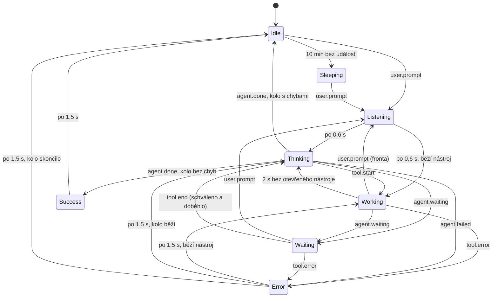
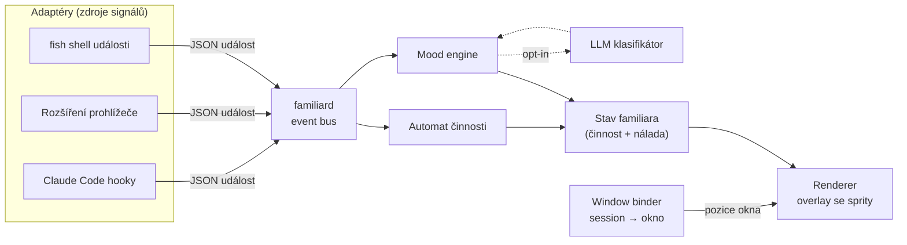
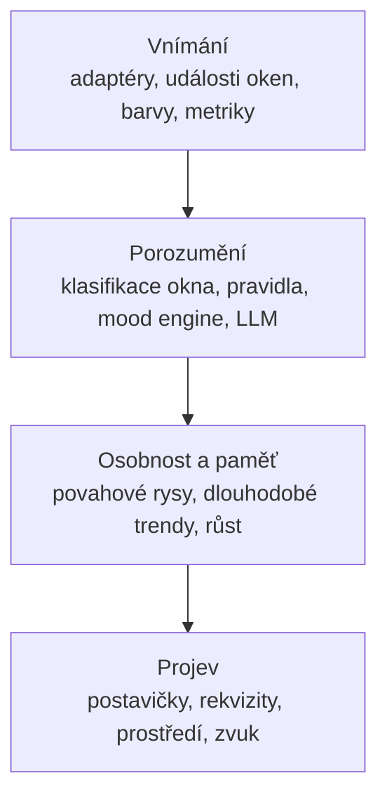

# Pixel Familiars — živí avataři oken

*Koncept a návrh · 15. 10. 2026*

## Obsah

1. [Koncept v kostce](#1-koncept-v-kostce)
2. [MVP: familiar u chatu s AI agentem](#2-mvp-familiar-u-chatu-s-ai-agentem)
3. [Model nálady](#3-model-nálady)
4. [Architektura](#4-architektura)
5. [Sprity a animace](#5-sprity-a-animace)
6. [Adaptéry: odkud familiar bere signály](#6-adaptéry-odkud-familiar-bere-signály)
7. [Plný rozkvět: samoasociovatelné prvky](#7-plný-rozkvět-samoasociovatelné-prvky)
8. [Roadmapa, rizika, soukromí, výkon](#8-roadmapa-rizika-soukromí-výkon)

---

## 1. Koncept v kostce

Pixel Familiar je malá 16bitová postavička (sprite 32×32 px, 16 barev). Sedí na okraji konkrétního okna a svou animací ukazuje, v jakém stavu to okno je. V první verzi je přivázaná k chatu s AI agentem: ukazuje, co agent právě dělá a jakou náladu má konverzace.

Celý systém stojí na jedné rouře, která platí pro MVP i pro plnou verzi:

1. **Signály**: události z okna (agent přemýšlí, nástroj selhal, uživatel píše naštvaně).
2. **Interpretace**: mood engine z nich počítá stav činnosti a náladu.
3. **Stav**: stabilní, vyhlazený výsledek bez blikání.
4. **Projev**: sprite, výraz, emote bublina, barevná paleta.

Od klasického desktop petu se projekt liší v tom, že postavička nemá vlastní vymyšlený život. Je to **vizuální stavový řádek okna**. Na první pohled, bez čtení, poznáš, jestli agent čeká na tvé schválení, jestli se točí v chybách, nebo jestli konverzace začíná skřípat.

---

## 2. MVP: familiar u chatu s AI agentem

MVP sleduje jednu věc: session s AI agentem (primárně Claude Code v terminálu). Zobrazuje ji dvěma nezávislými vrstvami:

- **Činnost** říká, co agent právě dělá. Je přesná, protože vychází z událostí.
- **Nálada** říká, jak se konverzace vyvíjí. Je odhadnutá.

### Vrstva 1: činnost (tvrdé stavy)

| Stav | Kdy nastane | Co postavička dělá |
| --- | --- | --- |
| Idle | agent dokončil, uživatel nic nedělá | dýchá, občas mrkne |
| Listening | uživatel odeslal zprávu (krátce, ~0,6 s) | kývne, zvedne ucho |
| Thinking | agent generuje odpověď | ruka u brady, nad hlavou „…“ |
| Working | agent spouští nástroj (bash, edit, search) | kutí s nářadím podle typu nástroje |
| Waiting | agent čeká na schválení nebo odpověď | mává, nad hlavou „!“ |
| Success | úkol dokončen bez chyby | krátký poskok, pak Idle |
| Error | nástroj selhal, testy spadly | zakopne, kapka potu |
| Sleeping | 10 min bez aktivity | sedí a podřimuje, „Zzz“ |

Nejcennější funkcí celého MVP je stav **Waiting**. Agent, který v okně na pozadí čeká na povolení, dnes stojí nejvíc ztraceného času. Postavička ho ukáže bez otravných notifikací.

### Vrstva 2: nálada (měkké stavy)

Nálada nemá vlastní animaci těla. Mění obličej, barevnou paletu a emote nad hlavou, zatímco tělo dál hraje činnost. Postavička tak může „přemýšlet frustrovaně“ nebo „pracovat spokojeně“. Díky tomu stačí 8 animací těla a 6 obličejů místo 48 kombinací.

| Nálada | Typický signál | Projev |
| --- | --- | --- |
| Klid | běžný průběh | neutrální obličej, základní paleta |
| Radost | poděkování, zelené testy | úsměv, teplá paleta, srdíčko |
| Zvědavost | dotazy, průzkum kódu | velké oči, „?“ |
| Frustrace | opakované opravy, chyby, ostrý tón | zamračení, tmavší paleta, kapka potu |
| Zmatek | uživatel říká „to jsem nemyslel“ | točící se spirála nad hlavou |
| Únava | dlouhá session, mnoho kol | přivřené oči, pomalejší animace |

### Chování na obrazovce

- Postavička sedí na horní hraně svého okna a při přesunu okna jde s ním.
- Když je okno minimalizované, sedne si do rohu obrazovky, aby stav Waiting zůstal vidět.
- Kliknutím se otevře malý panel s grafem nálady za poslední hodinu a poslední událostí.
- Přetažením na jiné okno ji ručně převážeš.
- Pravé tlačítko nabídne: ztlumit, uspat, změnit skin.
- **Pravidlo klidu:** nejvýš jedna výrazná animace za 5 s a v Idle žádný pohyb kromě dýchání. Postavička nesmí rušit víc než ikonka v liště.

---

## 3. Model nálady

Činnost řídí deterministický stavový automat. Náladu počítá spojitý model, který převádí signály na dvě čísla a ta až potom na štítek.

### 3.1 Stavový automat činnosti



Success a Error jsou **jednorázové stavy**: přehrají se jednou a automat se sám vrátí dál. Činnost má vždy přednost před náladou: když agent čeká na schválení, postavička mává bez ohledu na to, jak je „naladěná“.

Implementace je v `familiar/fsm.py`. Upřesnění podle nahrávek:

- Automat počítá otevřená `tool_use_id`; nástroje subagentů (`data.agent`) jen oddalují usnutí.
- Prompt během kola (fronta) kolo neukončí a nevynuluje chyby. Nástroje otevřené přes nový prompt přestanou držet Working, protože mohlo jít o přerušení.
- Po schválení příkazu žádný hook nepřijde, takže Waiting trvá až do konce nástroje. U většiny příkazů (medián 0,2 s) to nevadí.
- Přehrání všech 73 nahrávek (`python -m familiar.replay`): 25 % bdělého času Thinking, 17 % Working, 24 % Waiting (většinou neodpovězené otázky). Zbývá asi 150 krátkých záblesků Thinking mezi nástroji s mezerou 2–3 s a 77 záblesků Working, protože `PermissionRequest` přijde 0,1 s po `PreToolUse`. Obojí má vyhladit renderer minimální délkou animace.
- Session ukončená pádem nebo restartem nepošle `SessionEnd` (v datech jednou 2,5 h ve stavu Thinking). Daemon proto musí hlídat, jestli proces `claude` ještě žije.

### 3.2 Nálada jako dvě čísla

Nálada je bod v rovině (Russellův model emocí):

- **valence** `v ∈ ⟨−1, 1⟩`: příjemné ↔ nepříjemné
- **aktivace** `a ∈ ⟨0, 1⟩`: klidné ↔ vybuzené

Každý signál přidá impulz. Mezi impulzy se obě hodnoty exponenciálně vracejí k výchozí úrovni, takže jedna chyba náladu nezkazí natrvalo:

```
v(t) = v₀ + (v(t−Δt) − v₀) · e^(−Δt/τ_v) + Σ wᵢ · sᵢ
```

Valence se vrací pomalu (`τ_v ≈ 300 s`), aktivace rychle (`τ_a ≈ 90 s`). Naštvání tedy rychle opadne, ale pachuť chvíli zůstane.

Vedle toho běží dva čítače, které nejsou na ose valence:

- **zmatek**: počet korekcí za posledních 5 minut,
- **únava**: délka session a počet kol, plus událost komprimace kontextu.

### 3.3 Signály a váhy

Výchozí váhy jsou odhad. Ladí se přehráváním nahraných session (viz kapitola 8).

| Signál | Zdroj | Δ valence | Δ aktivace | Poznámka |
| --- | --- | --- | --- | --- |
| Poděkování, pochvala („díky“, „super“, „paráda“, „thanks“) | text uživatele | +0,25 | +0,05 | |
| Korekce („ne“, „to jsem nemyslel“, „zase špatně“) | text uživatele | −0,20 | +0,10 | zmatek +1 |
| Ostrý tón: VERZÁLKY, „!!!“, vulgarismy | text uživatele | −0,30 | +0,30 | |
| Opakovaná stejná prosba (podobnost > 0,8) | text uživatele | −0,20 | +0,20 | |
| Hodně otázek, průzkum („jak“, „proč“, „co dělá“) | text uživatele | +0,05 | +0,10 | podpoří Zvědavost |
| Chyba nástroje | agent | −0,10 | +0,15 | |
| 3 a více chyb za sebou | agent | −0,25 | +0,25 | místo jednotlivých |
| Testy nebo build prošly | agent | +0,20 | +0,10 | |
| Přerušení agenta (Esc) | agent | −0,15 | +0,20 | |
| Zamítnuté povolení | agent | −0,05 | +0,05 | |
| Komprimace kontextu | agent | 0 | 0 | únava +1 |
| LLM klasifikátor (volitelně) | každých 5 zpráv | posune k odhadu, váha 0,5 | posune k odhadu, váha 0,5 | |

**Implementace (`familiar/mood.py`), upraveno podle nahrávek:** poděkování +0,35 (jedno „díky“ už ukáže Radost), dokončené kolo bez chyb +0,06 valence, Zvědavost od aktivace 0,3, zmatek = počet korekcí v okně 5 minut, únava z aktivního času (pauzy nad 5 min se nepočítají, po 30 min klidu zmizí). Texty se hodnotí jen z prvních 160 znaků bez zpráv agentů (`<agent-message…>`), značek obrázků a cest, protože za vlastními slovy bývají vložené e-maily a dokumenty. Na 73 nahrávkách se nálada změnila asi 100× za 5 dní, většinu času je Klid.

Jednorázové reakce (emote vlevo nad hlavou, nejvýš jedna za 5 s): srdce (poděkování), fajfka (prošlé testy, build, DRC/ERC), „#!“ (ostrý tón), fotoaparát (obrázek v promptu), hrnek kávy (rate limit) a emote při změně nálady („?“, bouřkový mráček, spirála).

Textové heuristiky pracují s textem převedeným na malá písmena a bez diakritiky, se seznamy klíčových slov pro češtinu i angličtinu. Pro lepší přesnost lze později přidat malý lokální vícejazyčný sentiment model (ONNX, běží na CPU).

**Volitelný LLM klasifikátor** (opt-in): každých 5 zpráv pošle poslední 3 zprávy (zkrácené na 500 znaků) levnému modelu, například Claude Haiku 5.5 (`claude-haiku-5-5`), a dostane zpět JSON:

```json
{"valence": -0.4, "arousal": 0.6, "label": "frustrace", "confidence": 0.7}
```

Výsledek se nepoužije přímo, jen posune náladu k odhadu úměrně `confidence`. Heuristiky tak zůstávají základem a LLM jen opravuje to, co neumí (sarkasmus, kontext).

### 3.4 Z čísel na štítek, s hysterezí

*(Téma rozhovoru viz 3.6.)*

| Podmínka (vyhodnocuje se shora) | Nálada |
| --- | --- |
| zmatek ≥ 2 | Zmatek |
| v ≤ −0,3 a a ≥ 0,5 | Frustrace |
| únava ≥ 0,7 | Únava |
| v ≥ 0,3 | Radost |
| a ≥ 0,4 a v ≥ 0 a podíl otázek je vysoký | Zvědavost |
| jinak | Klid |

**Hystereze:** nový štítek se projeví, až když vyhrává nepřetržitě alespoň 4 s. Postavička tak nebliká mezi výrazy a na jednu ostrou větu nezareaguje přehnaně.

### 3.5 Jádro enginu (náčrt v Pythonu)

```python
import math, time

TAU  = {"v": 300.0, "a": 90.0}   # rychlost návratu k výchozí úrovni, s
BASE = {"v": 0.0,   "a": 0.2}
HOLD = 4.0                        # hystereze, s

class MoodEngine:
    def __init__(self):
        now = time.monotonic()
        self.m = dict(BASE)
        self.confusion = 0.0      # opadá stejně jako aktivace
        self.fatigue = 0.0        # 0..1, roste s délkou session
        self.t = now
        self.label = self.candidate = "klid"
        self.since = now

    def _decay(self, now):
        dt = now - self.t
        for k in self.m:
            self.m[k] = BASE[k] + (self.m[k] - BASE[k]) * math.exp(-dt / TAU[k])
        self.confusion *= math.exp(-dt / TAU["a"])
        self.t = now

    def impulse(self, dv=0.0, da=0.0, confusion=0.0):
        self._decay(time.monotonic())
        self.m["v"] = max(-1.0, min(1.0, self.m["v"] + dv))
        self.m["a"] = max(0.0, min(1.0, self.m["a"] + da))
        self.confusion += confusion

    def _classify(self):
        v, a = self.m["v"], self.m["a"]
        if self.confusion >= 2:   return "zmatek"
        if v <= -0.3 and a >= 0.5: return "frustrace"
        if self.fatigue >= 0.7:   return "unava"
        if v >= 0.3:              return "radost"
        return "klid"             # zvědavost doplní detektor otázek

    def tick(self):               # volat 2× za sekundu
        now = time.monotonic()
        self._decay(now)
        new = self._classify()
        if new != self.candidate:
            self.candidate, self.since = new, now
        elif new != self.label and now - self.since >= HOLD:
            self.label = new
        return self.label
```

### 3.6 Téma rozhovoru

`familiar/topic.py` sčítá body za klíčová slova v promptech, adresář projektu, nástroje (WebSearch → rešerše) a začátek příkazů Bash (`kicad-cli` → elektronika, `pytest`/`git` → kód). Body vyprchávají s poločasem asi 15 minut; téma se ukáže od 1,5 bodu a musí vést o 30 %. Téma určí pokrývku hlavy:

| Téma | Doplněk |
| --- | --- |
| elektronika | žlutá přilba se světlem v barvě antény |
| kód | sluchátka |
| web a design | baret |
| studium a psaní | promoční čepice se střapcem |
| rešerše | cestovatelský klobouk |
| systém | kšiltovka |

Subagenti se zobrazují jako malí drony vedle postavičky (nejvýš 3).

---

## 4. Architektura

Systém má pět částí, které spolu mluví přes lokální socket. Adaptéry jsou jediné místo, které zná konkrétní aplikaci. Všechno za nimi pracuje s obecnými událostmi.



| Komponenta | Úkol | MVP technologie |
| --- | --- | --- |
| Adaptér | převede události aplikace na společné schéma | `familiar emit` (Python skript, později Rust binárka) |
| familiard | sbírá události, drží stav každé session | Python 3 + asyncio, Unix socket v `$XDG_RUNTIME_DIR` |
| Automat činnosti | tvrdé stavy z kapitoly 3.1 | součást daemonu |
| Mood engine | valence, aktivace, štítek | součást daemonu |
| Window binder | ví, ke kterému oknu session patří a kde okno je | podle desktopu, viz níže |
| Renderer | kreslí sprity, přijímá stav přes WebSocket | Tauri v2 + Canvas 2D, nebo GNOME Shell rozšíření |

### Schéma události

Jedno společné schéma pro všechny adaptéry:

```json
{
  "v": 1,
  "source": "claude-code",
  "session": "a1b2c3",
  "pid": 48211,
  "ts": 1792083714.12,
  "kind": "tool.start",
  "data": {"tool": "Bash"}
}
```

Druhy (`kind`): `session.start`, `session.end`, `user.prompt`, `tool.start`, `tool.end`, `tool.error`, `tool.denied`, `agent.waiting`, `agent.done`, `agent.failed`, `agent.interrupted`, `subagent.start`, `subagent.done`, `context.compact`.

### Vazba session → okno (nejtěžší část)

1. Hook zná PID procesu agenta. Binder projde rodiče: `claude` → shell → emulátor terminálu.
2. PID terminálu přiřadí oknu:
   - **X11:** vlastnost `_NET_WM_PID` (EWMH), pozice přes `xdotool` / XCB.
   - **KDE Wayland:** KWin skript, který posílá `pid` a geometrii oken do daemonu.
   - **GNOME Wayland:** GNOME Shell rozšíření (`Meta.Window.get_pid()`, `get_frame_rect()`).
3. **Když je PID nejednoznačný** (např. `gnome-terminal-server` obsluhuje všechna okna jedním procesem), použije se okno, které mělo fokus při `session.start`. Přetažením postavičky jde vazbu kdykoli opravit.

**Ověřeno na KDE Wayland + kitty:** hook spouští přímo proces `claude`, řetěz je `claude → fish → kitty`. Každé okno kitty je samostatný proces a `KITTY_WINDOW_ID` je v něm vždy 1, takže okna rozliší jen PID procesu kitty (KWin skript, `window.pid`). Familiar se váže na PID procesu `claude`, ne na `session_id`: `/clear` a resume ve stejném okně založí novou session (jeden proces jich měl až 7). Při zavření okna přijde `SessionEnd` až po přesunu `claude` pod `systemd`, binder proto použije vazbu zapamatovanou dřív.

**Důležité omezení Waylandu:** běžná aplikace nesmí zjistit pozice cizích oken ani si sama nastavit pozici „vždy navrchu“. Proto má renderer tři režimy:

| Režim | Kde funguje | Jak |
| --- | --- | --- |
| `dock` | všude | samostatné malé okno, které si uživatel umístí sám; žádná vazba na pozici |
| `x11` / `kwin` | X11, KDE | průhledný overlay, který sleduje geometrii okna |
| `gnome-shell` | GNOME | sprity kreslí přímo rozšíření shellu, které zná okna nativně |

MVP začne v `dock` režimu (funguje hned) a vazbu na okno přidá v dalším kroku podle toho, jaký desktop používáš.

**Hotovo pro KDE (režim `perch`, výchozí):** daemon dohledá PID terminálu z rodičů procesu `claude` a každé postavičce dá malé okno (×2, 64 px) s titulkem `familiar|<pid terminálu>|<stav>|<počet kliků>`. KWin skript `familiar/perch.js`, který daemon sám nahraje přes D-Bus a při ukončení odebere, ji posadí na horní hranu terminálu vpravo vedle tlačítek titulku (když nad oknem není místo, dovnitř přes titulek). Zakrytý, minimalizovaný nebo na jiné ploše ležící terminál postavičku schová; ve stavu Waiting si ale sedne do pravého dolního rohu obrazovky. Klik na postavičku přepne na její terminál, kliky mimo pixely postavičky projdou do terminálu (maska okna). Okno je vždy navrchu díky pravidlu KWinu pro `wmclass=familiar`.

### Návrh struktury repozitáře

```
your-code-health/
├── familiar/              # Python balík: daemon + engine
│   ├── emit.py            # vstup z hooků
│   ├── hub.py             # jádro daemonu: zprávy → automat pro každý proces claude
│   ├── dock.py            # daemon + renderer (režimy perch a dock, PySide6), demo z nahrávek
│   ├── kwin.py, perch.js  # KWin skript: postavička sedí na okně terminálu
│   ├── sprites.py         # dočasný skin kreslený kódem
│   ├── fsm.py             # automat činnosti
│   ├── replay.py          # přehrávač nahrávek
│   ├── mood.py            # mood engine
│   ├── topic.py           # téma rozhovoru → doplněk na hlavě
│   ├── binder/            # x11.py, kwin.py, gnome.py
│   └── adapters/          # claude_code.py, shell.py, browser.py
├── renderer/              # Tauri app (dock + overlay)
├── gnome-extension/       # renderer pro GNOME Shell
├── skins/robo-kun/        # první skin
├── rules/                 # pravidla (fáze 3)
└── tests/                 # testy na syntetických událostech
```

Nahrané session obsahují texty promptů, proto leží mimo repozitář v `~/.local/share/familiar/replays/`.

---

## 5. Sprity a animace

### Technické parametry

- **Rozměr:** 32×32 px, zvětšení celočíselně ×3 (96 px na obrazovce), vždy nearest-neighbor (`image-rendering: pixelated`).
- **Paleta:** 16 barev na skin (4 bity, styl SNES), index 0 je průhlednost.
- **Snímková frekvence:** 4–8 fps podle animace. Pixel art nepotřebuje víc a šetří to CPU.
- **Nástroj:** Aseprite. Tagy jsou animace, export přes `aseprite -b skin.aseprite --sheet body.png --data body.json --format json-array --list-tags`.

### Vrstvy

Postavička se skládá za běhu ze čtyř vrstev:

| Vrstva | Řídí ji | Obsah |
| --- | --- | --- |
| `body` | činnost | animace těla (idle, think, work…) |
| `face` | nálada | 6 obličejů, každý se 2 snímky (mrknutí) |
| `fx` | události a nálada | emoty nad hlavou: „…“, „!“, „?“, srdce, pot, spirála, Zzz |
| `acc` | adaptér nebo pravidlo | doplňky: klíč při Bash, lupa při hledání, sluchátka… |

Každý snímek `body` má v JSON bod `face_anchor`, kam se kreslí obličej, aby seděl i při pohybu hlavy.

**Nálada přes výměnu palety:** místo dalších animací má každý skin 4 palety (základní, teplá, studená/tmavá, vybledlá). Výměna palety je klasická 16bitová technika: stojí nula snímků navíc a nálada je okamžitě znát.

### Seznam animací pro první skin

| Animace | Snímky | fps | Typ |
| --- | --- | --- | --- |
| idle | 4 | 4 | smyčka |
| listen | 4 | 8 | jednorázová |
| think | 6 | 6 | smyčka |
| work_bash / work_edit / work_search | 6 + 6 + 6 | 8 | smyčka |
| wave | 4 | 6 | smyčka |
| hop | 6 | 8 | jednorázová |
| stumble | 6 | 8 | jednorázová |
| sleep | 4 | 2 | smyčka |

Celkem asi 54 snímků těla, 12 obličejů a 7 emotů. To je pro jednoho člověka víkend práce v Aseprite.

### Přechody

- Každá animace začíná a končí v **neutrální póze** (snímek 0). Přechod počká na konec smyčky, nejdéle však 250 ms, potom přeskočí. Nic tak neprobliká.
- Jednorázové animace (hop, stumble, listen) se po dohrání vrátí do stavu, který určí automat.
- Výměna palety při změně nálady proběhne plynule ve 3 krocích po 80 ms.

### Balíček skinu

```toml
[skin]
id = "robo-kun"
name = "Robo-kun"
size = [32, 32]
scale = 3
anchor = [16, 31]          # bod, kterým postavička sedí na hraně okna

[layers]
body = "body.png"          # + body.json z Aseprite
face = "face.png"
fx   = "fx.png"
acc  = "acc.png"

[palettes]
base  = "pal/base.gpl"
warm  = "pal/warm.gpl"
cold  = "pal/cold.gpl"
faded = "pal/faded.gpl"

[activity]                 # stav činnosti → tag animace
idle      = "idle"
listening = "listen"
thinking  = "think"
working   = { Bash = "work_bash", Edit = "work_edit", Grep = "work_search", default = "work_edit" }
waiting   = "wave"
success   = "hop"
error     = "stumble"
sleeping  = "sleep"

[mood]                     # nálada → obličej + paleta + emote
klid      = { face = "neutral", palette = "base" }
radost    = { face = "smile",   palette = "warm",  fx = "heart" }
zvedavost = { face = "wide",    palette = "base",  fx = "question" }
frustrace = { face = "frown",   palette = "cold",  fx = "sweat" }
zmatek    = { face = "dizzy",   palette = "base",  fx = "spiral" }
unava     = { face = "tired",   palette = "faded" }
```

---

## 6. Adaptéry: odkud familiar bere signály

### 6.1 Claude Code (MVP)

Claude Code umí spouštět příkazy při událostech (hooky) a předává jim JSON na stdin. To je ideální zdroj: přesný, okamžitý a bez parsování obrazovky.

| Hook Claude Code | Událost familiara | Pozn. |
| --- | --- | --- |
| `SessionStart` | `session.start` | `source`: startup / clear / resume / compact |
| `UserPromptSubmit` | `user.prompt` | text promptu jde do textových heuristik |
| `PreToolUse` | `tool.start` | `tool_name` určí animaci práce, `tool_use_id` páruje konec |
| `PostToolUse` | `tool.end` | vždy úspěch, chybu nenese |
| `PostToolUseFailure` | `tool.error` | u Bash `error` = `"Exit code N\n<stderr>"`; kód 143/144 (zabitý proces) → `tool.end` |
| `PermissionRequest` | `agent.waiting` | přijde hned; `AskUserQuestion` = otázka, ostatní = povolení |
| `PermissionDenied` | `tool.denied` | jen zamítnutí klasifikátorem auto módu |
| `Stop` | `agent.done` | `background_tasks` ≠ [] → subagenti ještě pracují |
| `StopFailure` | `agent.failed` | `error`: rate_limit, server_error, authentication_failed |
| `SubagentStart` / `SubagentStop` | `subagent.start` / `subagent.done` | `SubagentStop` s prázdným `agent_type` se zahodí |
| `PreCompact` | `context.compact` | zvyšuje únavu |
| `SessionEnd` | `session.end` | postavička odejde |

`Notification` se nepoužívá: chodí opožděně (žádost o povolení 6 s po `PermissionRequest`, „čekám na vstup“ přesně 60 s po `Stop`) a nic nového nepřináší.

Události nástrojů, které mají pole `agent_id`, patří subagentům. Adaptér je předá s `data.agent` a automat hlavní postavičky je ignoruje (využijí se ve fázi 4 pro mláďata).

Přerušení (Esc) nemá vlastní hook a pole `is_interrupt` v `PostToolUseFailure` se v nahrávkách nikdy nenastavilo. Daemon ho pozná sledováním konce souboru `transcript_path` (řádek s `[Request interrupted by user`). Přerušení je vzácné (asi 6 za 5 dní), automat proto zatím jen nevěří nástrojům, které zůstaly otevřené přes nový prompt.

> **Zjištěno z nahrávek** (17.–22. 10. 2026, 73 session, 21 227 hooků, auto mód):
> - Chyba nástroje přichází jen jako `PostToolUseFailure` (210×, z toho 203× Bash). `PostToolUse` nemá exit kód ani `is_error`. Neprázdný stderr má i 604 úspěšných příkazů, `grep` bez shody (kód 1) chodí jako úspěch s `returnCodeInterpretation`.
> - Asi 30 % promptů přijde během běžícího kola (zpráva ve frontě), takže mezi dvěma `UserPromptSubmit` nemusí být `Stop`.
> - Hlavní agent často spouští nástroje souběžně (171×); automat musí počítat otevřená `tool_use_id`.
> - 29 % událostí nástrojů je od subagentů. 98 % `SubagentStop` jsou vnitřní pomocná volání bez `SubagentStart` a s prázdným `agent_type`.
> - Od promptu k prvnímu nástroji uplyne typicky 14 s, mezi nástroji 10,7 s (jen 9 % mezer je kratších než 2 s). Bash trvá typicky 0,2 s.
> - `PermissionRequest` následuje 0,1 s po `PreToolUse` téhož nástroje a nemá `tool_use_id`. Po schválení už nic nepřijde, dokud nástroj neskončí; odmítnutí se projeví jen novým promptem.

Konfigurace v `~/.claude/settings.json`:

```json
{
  "hooks": {
    "SessionStart":     [{ "hooks": [{ "type": "command", "command": "familiar-emit claude-code" }] }],
    "UserPromptSubmit": [{ "hooks": [{ "type": "command", "command": "familiar-emit claude-code" }] }],
    "PreToolUse":       [{ "matcher": "*", "hooks": [{ "type": "command", "command": "familiar-emit claude-code" }] }],
    "PostToolUse":      [{ "matcher": "*", "hooks": [{ "type": "command", "command": "familiar-emit claude-code" }] }],
    "PostToolUseFailure": [{ "matcher": "*", "hooks": [{ "type": "command", "command": "familiar-emit claude-code" }] }],
    "PermissionRequest":  [{ "matcher": "*", "hooks": [{ "type": "command", "command": "familiar-emit claude-code" }] }],
    "PermissionDenied":   [{ "matcher": "*", "hooks": [{ "type": "command", "command": "familiar-emit claude-code" }] }],
    "Stop":             [{ "hooks": [{ "type": "command", "command": "familiar-emit claude-code" }] }],
    "StopFailure":      [{ "hooks": [{ "type": "command", "command": "familiar-emit claude-code" }] }],
    "SubagentStart":    [{ "hooks": [{ "type": "command", "command": "familiar-emit claude-code" }] }],
    "SubagentStop":     [{ "hooks": [{ "type": "command", "command": "familiar-emit claude-code" }] }],
    "PreCompact":       [{ "hooks": [{ "type": "command", "command": "familiar-emit claude-code" }] }],
    "SessionEnd":       [{ "hooks": [{ "type": "command", "command": "familiar-emit claude-code" }] }]
  }
}
```

Tři pravidla pro `familiar-emit`, aby nikdy nerozbil agenta:

1. **Nic nevypisuje na stdout.** Výstup hooku `UserPromptSubmit` se přidává do kontextu agenta.
2. **Vždy skončí s kódem 0.** Jiný kód může blokovat nástroj nebo prompt.
3. **Je rychlý a neblokuje.** Pošle datagram s timeoutem 50 ms; když daemon neběží, událost zahodí.

```python
#!/usr/bin/env python3
# familiar-emit: hook → familiard. Nikdy nic nevypisuje, vždy exit 0.
import json, os, socket, sys, time

SOCK = os.path.join(os.environ.get("XDG_RUNTIME_DIR", "/tmp"), "familiar.sock")
# pole hooku, která adaptér potřebuje; tool_input/tool_response se neposílají
KEEP = ("hook_event_name", "session_id", "transcript_path", "cwd", "source", "reason",
        "prompt", "tool_name", "tool_use_id", "duration_ms", "error", "is_interrupt",
        "agent_id", "agent_type", "background_tasks", "trigger", "notification_type")

def main():
    raw = json.load(sys.stdin)
    raw = {k: raw[k] for k in KEEP if k in raw}
    if "prompt" in raw:
        raw["prompt"] = raw["prompt"][:2000]
    if isinstance(raw.get("error"), str):
        raw["error"] = raw["error"][:500]
    evt = {
        "v": 1,
        "source": sys.argv[1] if len(sys.argv) > 1 else "unknown",
        "pid": os.getppid(),   # proces claude, hook ho spouští přímo
        "ts": time.time(),
        "raw": raw,
    }
    s = socket.socket(socket.AF_UNIX, socket.SOCK_DGRAM)
    s.settimeout(0.05)
    s.sendto(json.dumps(evt).encode(), SOCK)

try:
    main()
except Exception:
    pass  # familiar nesmí nikdy ovlivnit agenta
sys.exit(0)
```

Překlad `hook` → `kind` (tabulka výše) dělá až daemon v `familiar/adapters/claude_code.py`. Emitter tak zůstane hloupý a rychlý a stejný překlad jde pustit i nad nahrávkami (`python -m familiar.replay`).

Naměřená režie emitteru v Pythonu je asi 25 ms na hook (start interpretu), tedy nad cílem z kapitoly 8. Fáze 0 navíc zapisovala každou událost na disk; ostrá verze už nahrávky nezapisuje.

### 6.2 fish shell

Obecný terminál bez agenta: úspěšné a neúspěšné příkazy ovlivňují náladu, dlouhé příkazy spouštějí stav Working.

```fish
# ~/.config/fish/conf.d/familiar.fish
function __familiar_pre --on-event fish_preexec
    echo "{\"hook\":\"cmd.start\",\"cmd\":\"$argv[1]\"}" | familiar-emit shell
end

function __familiar_post --on-event fish_postexec
    set -l st $status
    echo "{\"hook\":\"cmd.end\",\"status\":$st}" | familiar-emit shell
end
```

U shellu musí být `familiar-emit` co nejrychlejší, protože běží u každého příkazu. Start Pythonu (~30 ms) je tu znát, proto se emit později přepíše do Rustu (pod 2 ms). Text příkazu je v náčrtu vložený do JSON bez escapování. Skutečná verze ho musí escapovat, nebo emit dostane příkaz jako argument.

### 6.3 Prohlížeč (chat na webu)

- Rozšíření prohlížeče s content scriptem sleduje DOM chatu (`MutationObserver`): nová zpráva uživatele, streamování odpovědi, konec odpovědi.
- Do daemonu posílá události přes native messaging (prohlížeč nesmí přímo na Unix socket).
- Každá podporovaná stránka má vlastní malý „selektorový profil“. DOM se mění, proto jsou profily oddělené od logiky a snadno se aktualizují.

### 6.4 Obecné API

Cokoli dalšího (skript, CI, editor) pošle událost stejným socketem nebo přes `familiar-emit custom`. Tím je otevřená cesta pro kapitolu 7.

---

## 7. Plný rozkvět: samoasociovatelné prvky

V plné verzi už familiar není přilepený k jednomu chatu. Sám si najde okna, pochopí, co v nich je, převezme jejich styl a podle pravidel mění podobu a náladu. Z jedné postavičky se stává **vrstva živých prvků nad celým desktopem**.

### 7.1 Vrstvy plné verze



### 7.2 Samoasociace: familiar si najde okno sám

Daemon sleduje vznik a zánik oken. Každé nové okno klasifikuje podle `app_id`/`WM_CLASS`, titulku a stromu procesů a přidělí mu „druh“ familiara a sadu signálů:

| Typ okna | Druh familiara | Co je „nálada“ okna |
| --- | --- | --- |
| Terminál s AI agentem | robot | nálada chatu (kapitola 3) |
| Terminál bez agenta | krtek | exit kódy, délka příkazů |
| Editor / IDE | sova | počet chyb z LSP, neuložené změny, neodeslané commity |
| Prohlížeč | liška | počet tabů, přehrávání videa, stránka chatu → adaptér 6.3 |
| Hudební přehrávač | žába | tempo skladby (BPM) → rychlost tance |
| Videohovor | žádný | familiar se schová (soukromí a klid) |
| E-mail / chat | holub | nepřečtené zprávy |

Okna, která spolu souvisí (stejný `cwd` nebo git kořen), se propojí do **projektu**. Editor a terminál téhož repozitáře pak sdílí část nálady.

### 7.3 Přizpůsobení stylu okna

- **Barvy:** z okna (screenshot jen se souhlasem pro danou aplikaci) nebo z jeho tématu se metodou median cut vytáhne 16 barev. Paleta skinu se na ně přemapuje podle jasu: nejtmavší na nejtmavší, akcent na akcent. Postavička pak vypadá, jako by k aplikaci patřila.
- **Světlý / tmavý režim:** automaticky se přepne obrys (tmavý na světlém pozadí a naopak), aby postavička byla vždy čitelná.
- **Kostýmy:** doplňky (`acc`) podle typu okna: sluchátka u přehrávače, brýle v editoru, šála v pozdních hodinách.
- **Měřítko:** na HiDPI ×4, u malých oken ×2. Vždy celočíselně.

### 7.4 Logika: engine pravidel

Chování je popsané deklarativními pravidly, ne natvrdo v kódu. Uživatelé i komunita tak mohou přidávat vlastní:

```yaml
# rules/editor.yaml
- name: neulozena-prace
  when:
    window.kind: editor
    git.dirty_files: "> 20"
    for: 45m
  then:
    mood: { valence: -0.2, arousal: +0.2 }
    fx: disk
    say: "commitnem?"

- name: hudba
  when:
    window.kind: player
    media.playing: true
  then:
    activity: dance
    tempo: "{media.bpm}"

- name: pozde-v-noci
  when:
    clock.hour: ">= 23"
    session.length: "> 2h"
  then:
    acc: scarf
    fatigue: +0.3
```

Pořadí priorit při konfliktu:

1. tvrdý stav činnosti (Waiting vždy vyhraje),
2. pravidla, a mezi nimi to konkrétnější,
3. mood engine.

Každé pravidlo je čistá funkce `(signály, stav) → impulzy a projevy`, takže jde testovat přehráním nahraných dat.

### 7.5 Ekosystém prvků, nejen postavičky

- **Subagenti jako mláďata:** když Claude Code spustí subagenty, od hlavního familiara odběhnou malé kopie. Vrátí se při `SubagentStop`, úspěšné s úlovkem a neúspěšné s obvazem.
- **Rekvizity:** kytička na hraně okna roste s produktivní session a při chybách povadne. **Nikdy neumře.** Projekt nesmí trestat.
- **Počasí okna:** když spadne CI nebo testy, nad oknem chvíli prší. Po opravě vyjde duha.
- **Setkání familiarů:** postavičky oken stejného projektu na sebe mávají. Když se v terminálu spustí testy, sova v editoru nastraží uši a s výsledkem jí robot donese „dopis“.
- **Zvuk (volitelný):** tiché 8bitové pípnutí jen u stavu Waiting, jinak ticho.

### 7.6 Osobnost a paměť

- **Povahové rysy** (energie, upovídanost, odvaha) jsou parametry skinu. Mění prahy a četnost animací: líný familiar reaguje jen na velké věci, upovídaný ukáže každou drobnost.
- **Dlouhodobá paměť** ukládá jen agregáty, například týdenní křivku nálady nebo „nejtěžší hodinu dne“. Panel pak řekne: „Úterky po obědě bývají drsné.“
- **Růst:** dokončené úkoly familiar pomalu vyvíjí (nové doplňky, nová animace). Jen kosmeticky, bez závazků a bez výčitek.

### 7.7 Generované skiny

Uživatel popíše postavičku („liška v pracovním kabátě“). Obrazový model vygeneruje návrh, který se automaticky zpracuje:

1. kvantizace na 16 barev,
2. přichycení na mřížku 32×32,
3. vynucení šablony (stejné kotevní body a počty snímků jako referenční skin),
4. validace (čitelnost obrysu, kontrast obličeje).

Výsledek je výchozí bod pro ruční úpravu v Aseprite, ne hotový produkt.

### 7.8 Platforma

- **Pluginy tří typů:** adaptéry (vnímání), skiny (projev), pravidla (logika).
- **Podepsané balíčky:** adaptér běží s přístupem k událostem, takže musí být důvěryhodný.
- **Galerie komunity** pro skiny a sady pravidel.

---

## 8. Roadmapa, rizika, soukromí, výkon

### Roadmapa

Každá fáze má bránu: podmínku, která musí platit, než se jde dál.

1. **Fáze 0: prototyp** (1–2 víkendy). Hooky Claude Code → `familiar-emit` → daemon → renderer v `dock` režimu, jeden skin, 8 stavů činnosti, zatím bez nálady.
   *Brána:* v reálné session postavička správně ukáže Thinking, Working, Waiting a Error.
   *Stav:* postaveno, běží s živými hooky; brána zatím formálně nezapsaná.
2. **Fáze 1: MVP.** Mood engine s heuristikami, vazba na okno pro tvůj desktop (GNOME nebo KDE), formát skinu, panel s grafem nálady, ikona v liště.
   *Brána:* ve vzorku 50 okamžiků, kdy si sám zapíšeš náladu, se familiar trefí alespoň ve 35 (70 %).
   *Stav:* funkce hotové (viz „Stav k 22. 10. 2026“), brána se sbírá opravami z panelu nálady, vyhodnocuje ji `familiar tune`.
3. **Fáze 2: více zdrojů.** Adaptér fish, rozšíření prohlížeče, opt-in LLM klasifikátor, emit v Rustu.
   *Brána:* hook u každého příkazu shellu pod 5 ms.
4. **Fáze 3: samoasociace.** Klasifikace oken, druhy familiarů, přizpůsobení palety, engine pravidel.
   *Brána:* nové okno dostane správný druh familiara v 9 z 10 případů bez ručního zásahu.
5. **Fáze 4: ekosystém.** Subagenti jako mláďata, rekvizity, počasí, setkání familiarů, osobnost, galerie, generované skiny.

### Stav k 22. 10. 2026

Instalace a ovládání popisuje [README.md](README.md).

Hotovo (větev `produkt`):

- [x] **Balíček a instalace:** `install.sh` (uv / pipx / offline venv), příkaz `familiar` (run, stop, doctor, install, uninstall, upgrade, config, nastaveni, skins, tune, demo, replay), hooky se zálohou `settings.json`, pravidlo KWinu, `.desktop`, volitelný autostart.
- [x] **Konfigurace:** `~/.config/familiar/config.toml` s validací, číslem verze a migrací; změny za běhu bez restartu.
- [x] **GUI:** nabídka na postavičce, ikona v liště, dialog nastavení (zachová komentáře v souboru), tichý režim a režim soustředění, přepínání perch/dock za běhu.
- [x] **Skiny:** formát z Aseprite (`docs/skiny.md`), loader se zálohou na vestavěného Robo-kuna, exportér, skiny `robokun` a `rubin`, výběr v nabídce, plynulý přechod palet.
- [x] **Panel nálady a `familiar tune`:** graf valence a aktivace za hodinu, poslední události, potvrzení nebo oprava štítku (jen štítky a čísla do `opravy.jsonl`), přesnost, matice záměn, stav brány fáze 1 a návrh prahů.
- [x] **Přerušení (Esc)** z transcriptu session (zpoždění ≤ 0,75 s).
- [x] **Log** bez textů promptů s rotací, čistý konec (odebrání KWin skriptu i po chybě), `familiar doctor` s měřením emitteru.

Další:

- [ ] **Brána fáze 1:** nasbírat aspoň 50 oprav v panelu nálady a vyhodnotit je `familiar tune` (cíl ≥ 70 %). Návrh mění jen prahy `[nalada.prahy]`. Váhy signálů z oprav zpětně určit nejde, doladí se ručně podle matice záměn.
- [ ] **Skiny z Aseprite od uživatele:** dosavadní skiny jsou export Robo-kuna z kódu, první ručně kreslený skin podle `docs/skiny.md` chybí.
- [ ] **Známá omezení:**
  - Emitter je nad limitem 30 ms jen u obřích vstupů hooku (8 MB ~40 ms, 32 MB ~62 ms, většinu času zabere přenos rourou).
  - Při `uv` upgradu chybí `familiar-emit` na milisekundy a po upgradu je potřeba restartovat daemon.
  - Po uninstall + install se klíč `hooks` přesune na konec `settings.json`.
  - `okno.terminaly` platí jen pro nové postavičky.
  - Přerušení se může započítat dvakrát (příznak `is_interrupt` i transcript).
  - Dialog nastavení otevřený souběžně se změnou z nabídky ukazuje staré hodnoty.
  - Dvojklik v docku se na Waylandu může tlouct s tažením okna.

### Rizika

| Riziko | Dopad | Řešení |
| --- | --- | --- |
| Wayland nedovolí zjistit pozice oken | vazba na okno nefunguje | GNOME rozšíření / KWin skript; `dock` režim jako záloha |
| Špatné čtení nálady (sarkasmus, čeština, kontext) | postavička „lže“ a ztratí důvěru | konzervativní prahy, výchozí Klid, v panelu ukázat jistotu, uživatel může štítek v panelu potvrdit nebo opravit; `familiar tune` z oprav navrhne posun prahů `[nalada.prahy]` (váhy se ladí ručně) |
| Rušivost | uživatel familiara vypne | pravidlo klidu, režim soustředění, automatické schování při videohovoru |
| Změna formátu hooků nebo DOM | adaptér přestane fungovat | verzované schéma událostí, testy na nahraných datech, oddělené profily selektorů |
| Hook zpomalí agenta | horší práce s agentem | datagram s timeoutem, žádný výstup, vždy exit 0, emit v Rustu |

### Soukromí

- **Lokálně především.** Všechno běží na tvém počítači, socket je v `$XDG_RUNTIME_DIR` s právy jen pro tebe.
- **Texty se neukládají.** Zprávy se zpracují v paměti a zahodí. Historie nálady pro panel (vzorek valence a aktivace po 15 s za poslední hodinu) a druhy posledních událostí jsou jen v paměti daemonu. Na disk jdou jen opravy z panelu (`opravy.jsonl`: štítky, čísla, čas) a log bez textů.
- **LLM klasifikace je opt-in.** Posílá jen poslední 3 zprávy zkrácené na 500 znaků a v panelu je vidět, kdy k tomu došlo.
- **Screenshoty oken** (pro barvy v 7.3) jen se souhlasem pro konkrétní aplikaci. Nikdy se neukládají, uchová se jen výsledná paleta.

### Rozpočet výkonu

| Metrika | Cíl |
| --- | --- |
| CPU daemonu v klidu | < 0,5 % |
| Paměť (daemon + renderer) | < 80 MB |
| Doba běhu hooku | < 15 ms (Python), < 2 ms (Rust) |
| Událost → změna animace | < 100 ms |
| Vykreslování | 4–8 fps jen u viditelných familiarů, 0 fps když všichni spí |

### Další kroky

- [x] Zjistit desktop: KDE Plasma na Waylandu, terminál kitty → binder přes KWin skript a PID kitty.
- [ ] Nakreslit první skin v Aseprite: idle, think, work_edit, wave, hop, stumble + 3 obličeje.
- [x] Napsat `familiar-emit`.
- [x] Napsat daemon (`hub.py` + `dock.py`): socket, automat pro každý proces claude, kontrola, že proces žije.
- [x] Zapojit hooky Claude Code a nahrát reálné session (73 session, 17.–22. 10. 2026; nahrávání pak vypnuto).
- [x] Z nahrávek ověřit, jak vypadá chyba nástroje (kapitola 6.1).
- [x] Napsat automat činnosti a přehrávač nahrávek (`fsm.py`, `replay.py`).
- [x] Postavit renderer v `dock` režimu (PySide6, dočasný skin Robo-kun kreslený kódem v `sprites.py`).
- [x] Vazba na okno pro KDE Wayland (`perch.js` + `kwin.py`).
- [ ] Projít bránu fáze 0 v reálné session.
- [ ] Napsat přehrávač nahrávek pro mood engine a doladit váhy z tabulky 3.3.
